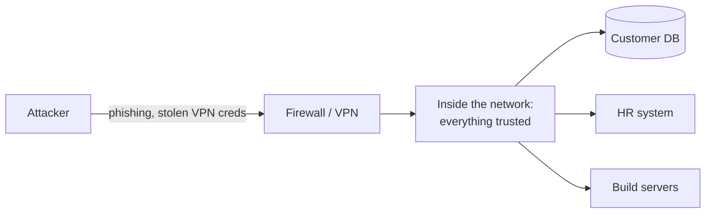
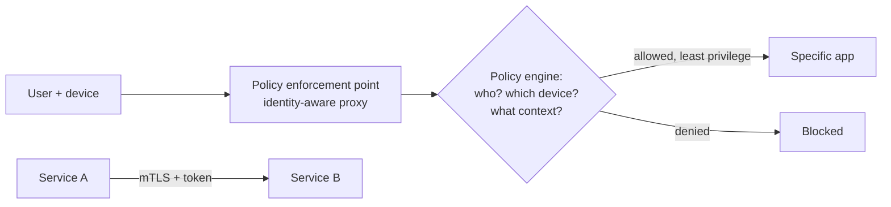

Zero Trust is a security model built on one rule: **never trust, always verify.** No request is trusted just because of *where* it comes from. Every request is authenticated, authorized and encrypted, even inside your own data center or VPC.

## Why the old model fails

The traditional model is **castle and moat**: a strong firewall at the edge, and anything inside the network is trusted.

Once an attacker gets in through one phished laptop, a leaked VPN password or a vulnerable server, they can move sideways to everything. Threats exist inside the network too, and with cloud services, remote work and SaaS, there isn't one clear "inside" anymore.

## The zero trust model

Access decisions are made **per request**, based on:

- **Identity:** who is the user or service? Strong authentication with SSO and MFA, and workload identities for services.
- **Device posture:** is the laptop managed, encrypted and patched?
- **Context:** location, time, behaviour, the sensitivity of the resource, risk signals.

## Core principles

- **Verify explicitly:** authenticate and authorize every request, every time. See [OAuth 2.0 and OIDC](/system-design/oauth-2-0-and-oidc/).
- **Least privilege:** grant the minimum access needed, for the shortest time (just-in-time access, short-lived credentials).
- **Assume breach:** design so that one compromised component can't reach everything. Segment the network, encrypt everything, log and monitor everything.

## How it's implemented

- **Identity provider + SSO + MFA** for every human login.
- **Identity-aware proxies / ZTNA** (for example Google BeyondCorp, Cloudflare Access, Zscaler) instead of a flat VPN. Users reach specific apps, not the whole network.
- **mTLS between services** with workload identities (for example SPIFFE, or a service mesh like Istio or Linkerd), so services authenticate each other. See the [TLS handshake](/system-design/tls-ssl-handshake/).
- **Microsegmentation:** network policies so a service can only talk to what it actually needs.
- **Short-lived credentials** from a secrets manager instead of long-lived keys.
- **Continuous monitoring** and anomaly detection on every access.

## Trade-offs

Zero trust adds complexity: identity infrastructure, policy management, certificate rotation, and some latency from extra checks. Organisations adopt it gradually, starting with SSO and MFA, then moving admin and internal tools behind an identity-aware proxy, then adding mTLS between services.

## In interviews

In modern architectures, zero trust is becoming the default approach: "Internal tools sit behind an identity-aware proxy with SSO and MFA, not a VPN. Services authenticate with mTLS and short-lived tokens, and each one can only reach the dependencies it needs." See also [security measures in system design](/system-design/security-measures-in-system-design/).
